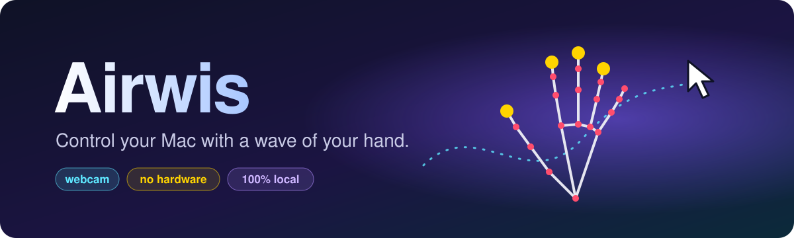
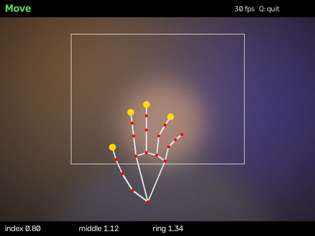
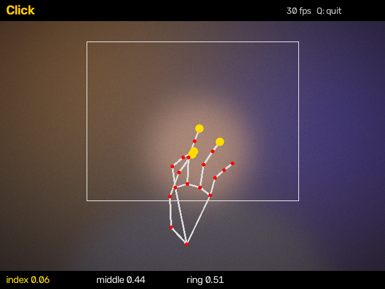
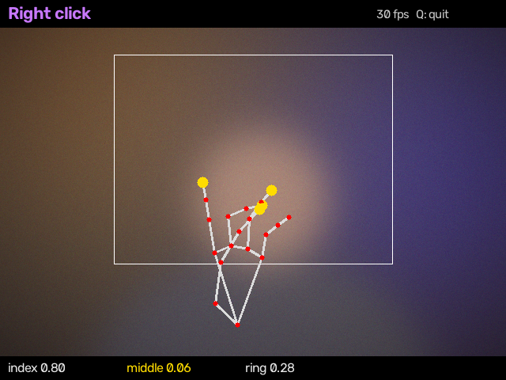
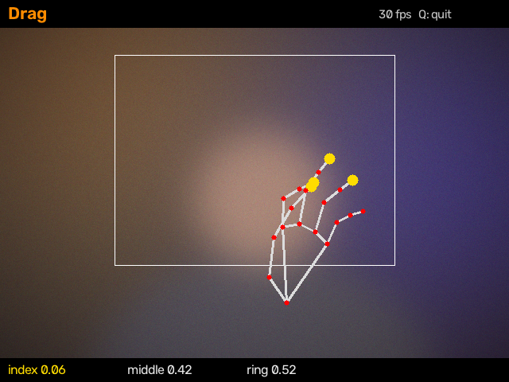
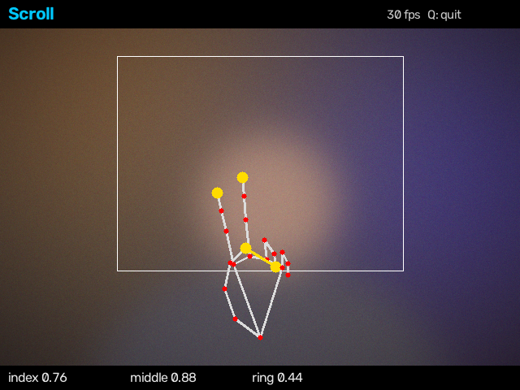
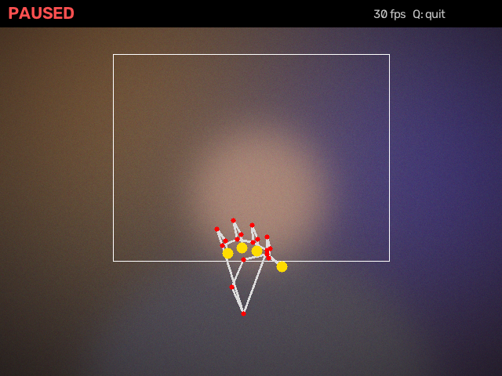
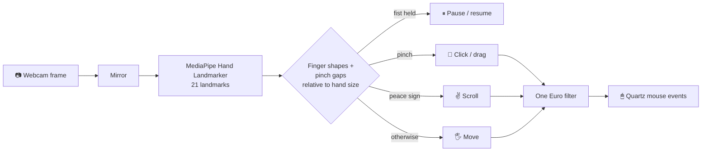

<p align="center">
  
</p>

<p align="center">
  
  
  
  
  
</p>

<p align="center">
  <b>Airwis</b> turns your Mac's built-in webcam into a touch-free mouse.<br>
  Point, pinch, drag and scroll in the air. No gloves, no extra hardware, nothing leaves your Mac.
</p>

<p align="center">
  <a href="#-quick-start">Quick start</a> ·
  <a href="#-gestures">Gestures</a> ·
  <a href="#-the-menu-bar-app">Menu bar app</a> ·
  <a href="#%EF%B8%8F-tuning">Tuning</a> ·
  <a href="#-how-it-works">How it works</a>
</p>

---

## ✨ Highlights

- 🖐 **One hand, full mouse**: move, left click, double click, right click, drag & drop, and scroll.
- 🎯 **Clicks land where you aim**: the cursor locks in place as your fingers close in, so pinching never nudges it.
- 🧈 **Smooth, not laggy**: a One Euro filter keeps the cursor steady when still and fast when you move.
- 📏 **Works near or far**: every distance is measured relative to your hand size.
- ✊ **Pause anytime**: hold a fist to stop tracking, hold it again to resume.
- 🍏 **Native feel**: lives in the menu bar, sends real macOS mouse, drag and scroll events.
- 🔒 **Private**: all tracking runs on-device with MediaPipe. No network calls after the one-time model download.

## 👋 Gestures

The preview window shows what Airwis sees: the hand skeleton, the **white active area** (the only part of the frame that maps to your screen), the current gesture, and the live thumb-to-finger gaps (a finger turns yellow when it counts as touching).

<table>
  <tr>
    <td align="center" width="33%">
      <br>
      <b>Move</b><br>
      <sub>Open hand. The cursor follows the point between your thumb and index tips.</sub>
    </td>
    <td align="center" width="33%">
      <br>
      <b>Click</b><br>
      <sub>Quick pinch, thumb + index.<br>Pinch twice quickly for a double click.</sub>
    </td>
    <td align="center" width="33%">
      <br>
      <b>Right click</b><br>
      <sub>Pinch thumb + middle finger, index stays up.</sub>
    </td>
  </tr>
  <tr>
    <td align="center">
      <br>
      <b>Drag &amp; drop</b><br>
      <sub>Pinch and hold (~0.35 s), move, then open your fingers to drop.</sub>
    </td>
    <td align="center">
      <br>
      <b>Scroll</b><br>
      <sub>Peace sign (index + middle up), then move your hand up or down.</sub>
    </td>
    <td align="center">
      <br>
      <b>Pause / resume</b><br>
      <sub>Hold a closed fist for ~0.6 s.</sub>
    </td>
  </tr>
</table>

| Gesture | Action |
|---|---|
| 🖐 Move your hand | Cursor follows the thumb–index midpoint (set `CURSOR_FINGER` to `"between"`, `"thumb"` or `"index"`) |
| 🤏 Quick pinch, thumb + index | Left click. Two quick pinches = double click |
| 🤏⏱ Pinch and hold, move, open | Click and drag, then drop |
| 👉 Pinch thumb + middle (index up) | Right click |
| 💍 Pinch thumb + ring (index up) | Double click |
| ✌️ Index + middle up, move up/down | Scroll |
| ✊ Hold a closed fist (~0.6 s) | Pause / resume tracking |
| ⌨️ `Q` or `Esc` in the preview | Quit (or `Ctrl+C` in the terminal) |

> [!NOTE]
> The pictures above are rendered by Airwis's own preview code (`draw_preview`) from posed hand landmarks, so they match exactly what you'll see on screen, minus your face. 🙂

## 🚀 Quick start

Needs **macOS** (Apple Silicon or Intel) and **Python 3.9+**.

```bash
git clone https://github.com/itssinghankit/airwis.git
cd airwis
python3 -m venv .venv
source .venv/bin/activate
pip install -r requirements.txt
```

Then pick one:

<table>
<tr>
<th>🍏 As a Mac app (recommended)</th>
<th>💻 From the terminal</th>
</tr>
<tr>
<td>

```bash
./build_app.sh --install
```

Builds `Airwis.app` and copies it to `~/Applications`.
Open it from Spotlight: <kbd>⌘</kbd> <kbd>Space</kbd> → “Airwis” → <kbd>Enter</kbd>.

</td>
<td>

```bash
python gesture_control.py
```

The first run downloads MediaPipe's hand model (`hand_landmarker.task`, ~8 MB) next to the script.

</td>
</tr>
</table>

### 🔐 Permissions (one time)

macOS grants permissions to the app you launch Airwis **from**: **Airwis** if you use the app, or your terminal (Terminal, iTerm, VS Code…) if you run the script.

| Permission | Where | Why |
|---|---|---|
| 📷 **Camera** | System Settings → Privacy & Security → Camera | To see your hand |
| 🖱 **Accessibility** | System Settings → Privacy & Security → Accessibility | To move and click the mouse |

Quit and reopen the app (or terminal) after changing either one. If Airwis doesn't show up in the Accessibility list, click **+** and pick it from `~/Applications`. The menu bar shows **⚠️ Allow mouse control** until Accessibility is on.

## 🧭 The menu bar app

```
 ┌──────────────────────────────────────┐
 │  🖐  ← Airwis lives here              │
 ├──────────────────────────────────────┤
 │  Stop tracking                        │
 │  ✓ Mouse control allowed              │
 │  Open log                             │
 │  ──────────────                       │
 │  Quit                                 │
 └──────────────────────────────────────┘
```

- **Opens tracking right away** when the app starts. 🖐 = tracking, ✋🏻 = stopped.
- **Stop / start**: click the hand in the menu bar.
- **Quit**: click the hand → Quit. Pressing `Q` or closing the preview stops tracking only.
- **Hidden behind the notch?** Open Airwis again (double-click or Spotlight) to start tracking or bring the preview to the front.
- **Something off?** *Open log* shows the tracker output, including live pinch numbers (`~/Library/Logs/Airwis.log`).

> [!TIP]
> The app runs the code in this folder. Edit `gesture_control.py`, then stop and start tracking to pick up the change. If you move the folder, run `./build_app.sh --install` again.

## 🎛️ Tuning

Sit about an arm's length from the camera, palm facing it, in decent light. Only the white box in the preview maps to the screen, so you never need to reach outside it.

Everything worth tuning lives in the `CONFIG` block at the top of [`gesture_control.py`](gesture_control.py):

| Problem | Change |
|---|---|
| Cursor too slow / need to move too far | Lower `ACTIVE_AREA_WIDTH` / `ACTIVE_AREA_HEIGHT` |
| Cursor shaky when still | Lower `SMOOTHING_MIN_CUTOFF` (e.g. `0.6`) |
| Cursor lags behind fast moves | Raise `SMOOTHING_BETA` (e.g. `0.015`) |
| Clicks fire too easily | Lower `PINCH_START` (e.g. `0.25`) |
| Pinch not detected | Raise `PINCH_START` (e.g. `0.36`) |
| Drag starts when you wanted a click | Raise `HOLD_TO_DRAG_SEC` |
| Scrolling backwards | `SCROLL_DIRECTION = -1` |
| Scrolling too fast / slow | `SCROLL_SPEED` |
| Wrong camera (iPhone Continuity Camera) | `CAMERA_INDEX = 1` |

## 🧠 How it works



- **Click doesn't jump**: once the pinch gap drops below `AIM_LOCK_START`, the cursor freezes and the click lands there. It also clicks where the cursor was `PINCH_LOOKBACK_SEC` before the pinch, undoing the small pull of your fingertip.
- **No flicker**: a pinch starts below `PINCH_START` but only ends above `PINCH_RELEASE` (hysteresis), must be seen for 2 frames in a row, and clicks have a short cooldown.
- **Never ambiguous**: right and double click require the thumb to be clearly closer to that finger than to the others (`PINCH_CLEARANCE`).
- **Safe**: if your hand leaves the frame mid-drag, or you quit, the mouse button is released.
- Only the main display is used.

## 📁 Project layout

```
airwis/
├── gesture_control.py   # the tracker: camera → landmarks → gestures → mouse events
├── menubar.py           # menu bar app that starts/stops the tracker
├── build_app.sh         # builds Airwis.app (add --install to copy it to ~/Applications)
├── requirements.txt
└── docs/images/         # README artwork
```

<p align="center"><sub>Made with 🖐 and a webcam.</sub></p>
